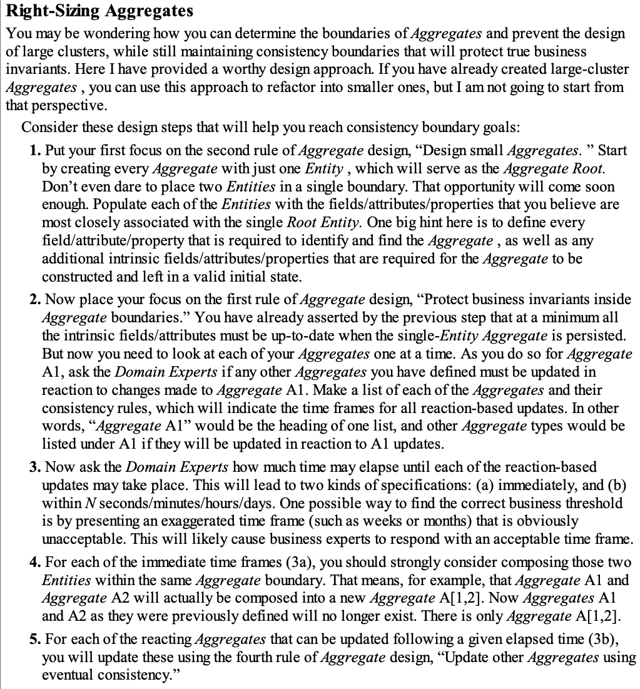
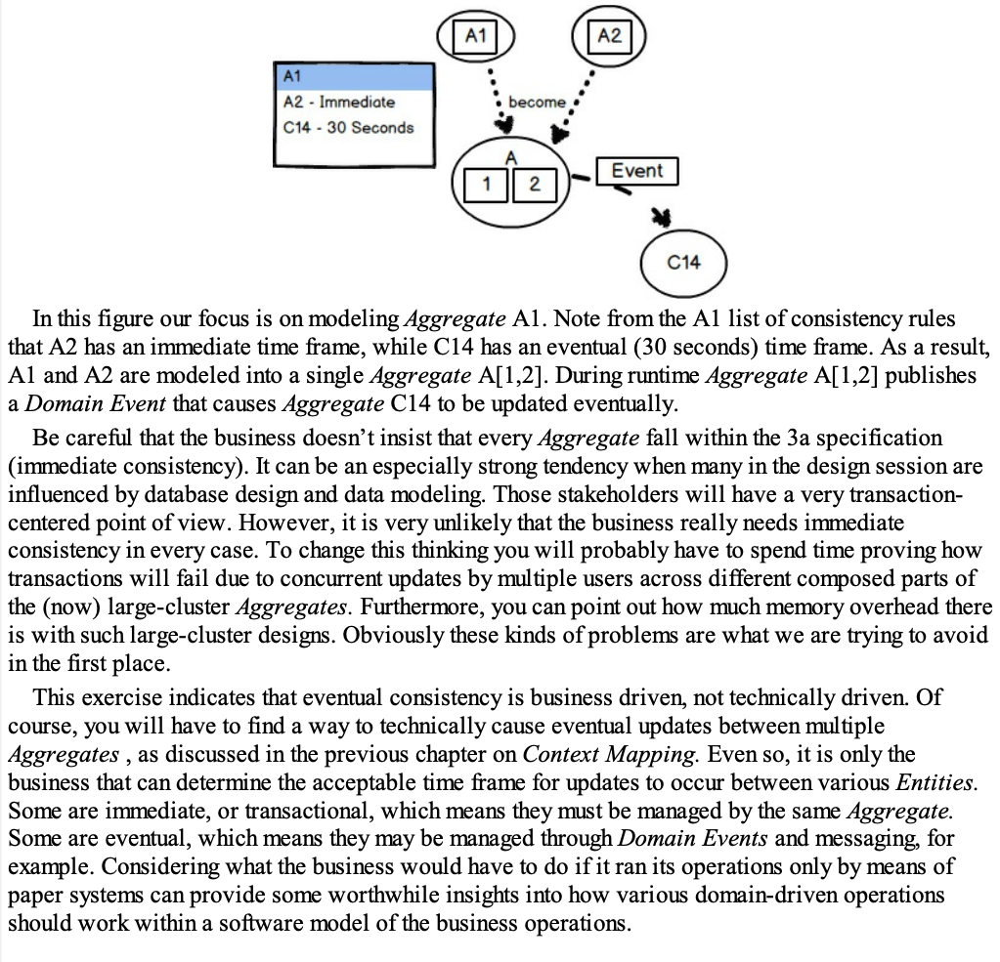
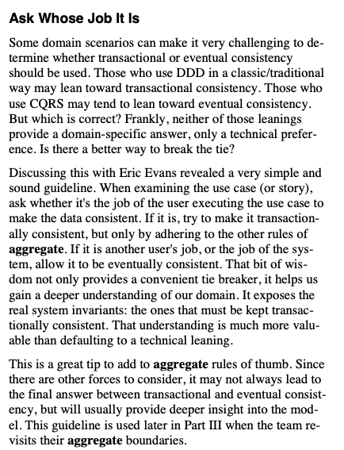

+++
title = "La bonne taille"
weight = 20
+++

> [!ressource] Ressources
> - [MUST READ - Effective Aggregate Design Part I: Modeling a Single Aggregate](https://www.dddcommunity.org/wp-content/uploads/files/pdf_articles/Vernon_2011_1.pdf)
> - [Effective Aggregate Design Part II: Making Aggregates Work Together](https://www.dddcommunity.org/wp-content/uploads/files/pdf_articles/Vernon_2011_2.pdf)
> - [Domain model purity and lazy loading](https://enterprisecraftsmanship.com/posts/domain-model-purity-lazy-loading/)
> - [DDD Aggregates: Consistency Boundary](https://www.jamesmichaelhickey.com/consistency-boundary/)
> - [Un très bon exemple](https://dcb.events/topics/aggregates)
> - Domain-Driven Design Distilled, Vaughn Vernon, p. 95

Déterminer la taille d'un agrégat est l'une des décisions les plus délicates de la conception d'un modèle de domaine. Il n'existe pas de réponse universelle : la taille résulte d'un arbitrage entre la garantie des invariants et le coût d'exécution.

## Un arbitrage entre cohérence et performance

> Aggregates define transactional boundaries in your application: any modification done to an aggregate must remain consistent at all times. Aggregates are also the largest structures whose invariants are guaranteed to be enforced by the domain model. **To enforce invariants that span more than one aggregate (such as user email uniqueness), you have to rely on out-of-process dependencies,** such as your database, or implement custom roll-back procedures. The domain model alone can't enforce such invariants. [^1]

Deux forces s'opposent :

- **Un agrégat volumineux gagne en exhaustivité du modèle.** Il permet d'appliquer davantage d'invariants au sein même du modèle de domaine, sans recourir à une dépendance hors processus. L'encapsulation est préservée, mais chaque modification impose de charger et de verrouiller un graphe d'objets important.

- **Un agrégat réduit fait le choix inverse.** Il gagne en performance et en parallélisme, au prix d'invariants que le modèle ne peut plus garantir seul et qui doivent être délégués à la base de données ou à un mécanisme de compensation.

## Les invariants dessinent la frontière

> Invariants should drive our aggregate design. [^2]

> [!definition] Définition
> Un **invariant** est une règle métier qui doit être vraie à tout instant observable, avant comme après chaque transaction.

La frontière d'un agrégat n'est donc pas déduite du modèle de données ni des relations entre tables. Elle est déduite des invariants : les objets qui doivent rester mutuellement cohérents de manière atomique appartiennent au même agrégat.

Il en découle une règle d'implémentation : **une transaction ne modifie qu'un seul agrégat**. Toute règle qui traverse plusieurs agrégats sort du périmètre que le modèle de domaine peut garantir par lui-même.

La difficulté consiste à distinguer les invariants réels des règles que le métier accepte de voir temporairement violées. Beaucoup de contraintes formulées comme absolues par les parties prenantes tolèrent en réalité un délai. Chacune de ces contraintes relâchées permet de réduire la taille d'un agrégat.

## Deux formes de cohérence

> There are different kinds of consistency. One is transactional, which is considered immediate and atomic. There is also eventual consistency. When discussing invariants, we are referring to transactional consistency. [^2]

- **Cohérence transactionnelle** — l'invariant est vérifié à l'intérieur de la transaction qui modifie l'agrégat. Il n'existe aucun instant où un observateur peut constater un état invalide. C'est le seul type de cohérence que la racine d'agrégat garantit.

- **Cohérence à terme** (*eventual consistency*) — l'état peut être temporairement incohérent. La convergence est assurée après coup, généralement par un événement de domaine traité de façon asynchrone. Le délai est non déterministe et doit être explicitement accepté par le métier.

## La question décisive : « Whose job is it? »

Pour arbitrer entre ces deux formes de cohérence, Vaughn Vernon reprend une heuristique attribuée à Eric Evans[^3] :

- si c'est le **travail de l'utilisateur qui exécute la commande** de maintenir les données cohérentes, alors la cohérence doit être transactionnelle : les objets concernés appartiennent au même agrégat ;
- si c'est le travail **d'un autre utilisateur ou du système**, alors la cohérence à terme est appropriée : les objets peuvent être répartis dans des agrégats distincts.

> Thus, if executing a command on one aggregate instance requires that additional business rules execute on one or more other aggregates, use eventual consistency. Accepting that all aggregate instances in a large-scale, high-traffic enterprise are never completely consistent helps us accept that eventual consistency also makes sense in the smaller scale where just a few instances are involved. Ask the domain experts if they could tolerate some time delay between the modification of one instance and the others involved. [^3]

Cette question déplace le débat du terrain technique vers le terrain métier. Elle est appliquée à un cas concret dans l'article suivant.

## En résumé

- Recenser les invariants réels, en écartant ceux qui tolèrent un délai.
- Pour chaque invariant, identifier à qui revient la responsabilité de le maintenir.
- Regrouper dans un même agrégat les seuls objets soumis à un invariant transactionnel commun.
- Relier les agrégats par identifiant, et propager les effets par événements de domaine.

[^1]: [Domain model purity and lazy loading](https://enterprisecraftsmanship.com/posts/domain-model-purity-lazy-loading/)
[^2]: [DDD Aggregates: Consistency Boundary](https://www.jamesmichaelhickey.com/consistency-boundary/)
[^3]: [Effective Aggregate Design Part II: Making Aggregates Work Together](https://www.dddcommunity.org/wp-content/uploads/files/pdf_articles/Vernon_2011_2.pdf)
